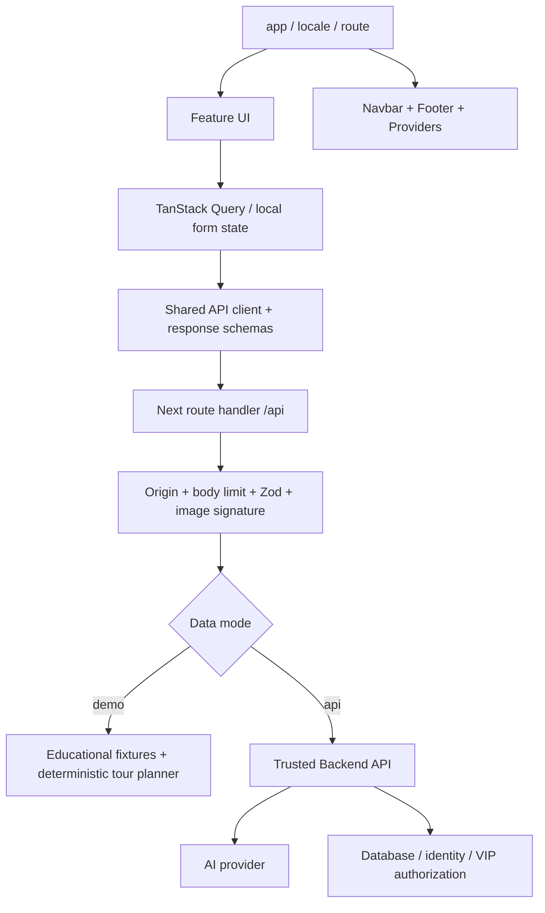

# Architecture & ownership

## Boundaries

- Routes in [app/](../src/app/) compose screens; feature behavior lives in [features/](../src/features/).
- [client.ts](../src/lib/api/client.ts) owns browser fetch, cancellation, safe errors and runtime response validation.
- [server.ts](../src/lib/api/server.ts) owns the allowlisted API bridge. It does not contain an AI key, a database connection or fake production authentication.
- [schemas.ts](../src/lib/api/schemas.ts) and [types/](../src/types/) describe external and internal contracts together. Update both when changing payloads.
- [messages/](../src/messages/) contains general copy. Feature dictionaries are colocated, merged centrally by [messages.ts](../src/lib/i18n/messages.ts), and checked for key parity.

## State and caching

| State                                     | Owner / lifetime                                         |
| ----------------------------------------- | -------------------------------------------------------- |
| Catalog and details                       | Query cache, 60 seconds stale time, one retry            |
| Tour / feedback POST                      | Explicit user action, no automatic write retries         |
| Search, filters, page                     | URL parameters, survives refresh and sharing             |
| Tour preferences                          | Validated localStorage, optional; no PII                 |
| Quiz progress                             | Bounded validated numeric array in localStorage          |
| VIP entitlement and signed audio metadata | Server response; private/no-store; cleared during change |
| Selected image preview                    | Blob URL revoked when replaced or unmounted              |
| Active network requests                   | AbortController on unmount/replacement                   |

## Accessibility and performance

Semantic navigation, skip link, visible focus, native form controls, error summaries, status regions, keyboard map pins and equivalent text list. Motion respects `prefers-reduced-motion`. Native audio does not autoplay and includes a transcript. Pages split by Next routing; QR generation is dynamically imported. Photographs use local precompressed responsive WebP assets, and only the hero and first visible catalog images are prioritized; unused route prefetch is disabled.

The demo map has one central floor connector and estimated walking times. It is not a real floor-plan graph. Replace it with an approved spatial graph and audited accessible edges before providing real directions.

## Integration responsibilities

Backend must own identity, verified VIP access, protected recordings, model calls, database writes and persistent feedback. The BFF forwards existing cookies/Authorization to the configured trusted backend; it does not establish a login itself. A production integration needs the team's actual session design, session expiration behavior and rate limits. Public demo mode intentionally carries no user credentials and stores no uploads or feedback.
