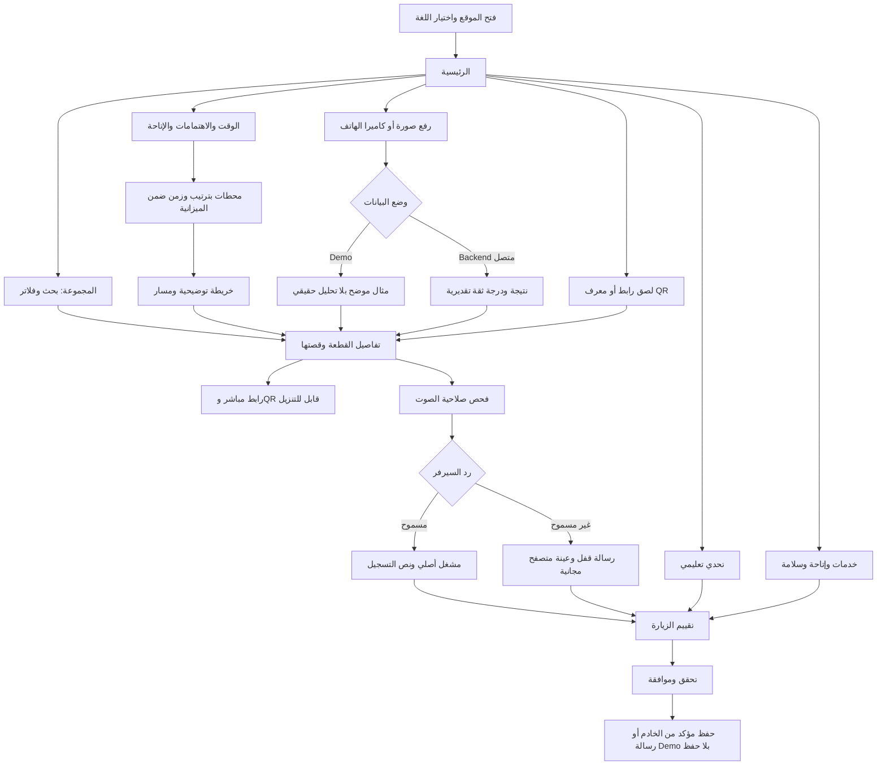

# GEM — رحلة الزائر والتصميم

الاتجاه البصري الحالي يستخدم ألوان الصحراء والرمل والطين والذهبي مع اللازورد والفيروزي، بوضعين فاتح وداكن وتقييم تفاعلي حديث. الواجهة المبرمجة نموذج عملي؛ لا يوجد ملف Figma أصلي ضمن التسليم الحالي.

## User flow

## Design tokens

القيم الفعلية مركزية في [globals.css](../src/app/globals.css)، ويمكن تعديلها عند اعتماد الهوية.

| الاستخدام                 | القيمة           |
| ------------------------- | ---------------- |
| الخلفية العاجية           | `#F7F1E5`        |
| الحبر الكحلي              | `#112A3B`        |
| ذهب داكن للنصوص والتفاصيل | `#805B18`        |
| السطح الرملي              | `#E7DAC1`        |
| الحدود                    | `#DED0B5`        |
| النص المساعد              | `#655F55`        |
| الفقرات                   | Manrope Variable |
| العناوين الإنجليزية       | Georgia          |
| العناوين العربية          | Cairo Variable   |

مسافات من 4 إلى 64px، عناوين مرنة باستخدام `clamp`، إطار تركيز واضح، صور لا تنعكس في RTL، وحقول البريد والروابط LTR. لا تنزيل خطوط إلزامي وقت البناء. النصوص والترجمات قابلة للتعديل دون تغيير المكونات.

## Wireframes وصفية

| الشاشة       | الكمبيوتر                                                | الموبايل                                 |
| ------------ | -------------------------------------------------------- | ---------------------------------------- |
| Home         | مقدمة بنص ورسم، إحصاءات، قطع مختارة، أدوات الجولة، خدمات | نص ثم رسم؛ بطاقات رأسية وتنقل قابل للفتح |
| Catalog      | بحث واضح وفلاتر، شبكة 3 أعمدة وترقيم                     | فلاتر تلتف وشبكة بعمود واحد              |
| Artifact     | رسم وحقائق في عمودين، قصة، QR، قطع مرتبطة                | رسم ثم قصة وإجراءات؛ QR ورابط قابل للنسخ |
| Tour planner | نموذج بجانب النتائج والمحطات                             | النموذج ثم النتائج، أزرار وخيارات واضحة  |
| Map          | SVG بجانب تفاصيل القطعة وقائمة بديلة أسفله               | مخطط متجاوب ثم التفاصيل والقائمة         |
| Scan         | رفع ومعاينة بجانب إرشادات ومثال منفصل                    | رفع ثم إرشادات؛ لا نتيجة AI مزعومة       |
| Audio        | اختيار القطعة بجانب حالة الصلاحية والمشغل                | ترتيب رأسي ونص تسجيل قابل للفتح          |
| Quest        | مقدمة وتقدم بجانب السؤال                                 | سؤال واحد كل مرة ثم نتيجة وتفسير         |
| Feedback     | نموذج محدود العرض وملخص أخطاء                            | حقول رأسية وزر كامل العرض                |
| Services     | شبكة بطاقات                                              | بطاقات في عمود واحد                      |

## حالات التفاعل

- Loading، Empty وError مع إجراء واضح؛ لا تمسح مدخلات الزائر عند خطأ الشبكة.
- منع الإرسال المتكرر وإلغاء الطلب عند استبدال الصورة أو مغادرة الشاشة.
- عرض Demo بوضوح، وإخفاء أي نسبة ثقة مصطنعة، وتأكيد عدم حفظ التقييم التجريبي.
- التحقق من VIP على السيرفر؛ العينة المجانية ليست التسجيل المميز.
- دعم الكيبورد، رابط تخطي للمحتوى، تسميات حقول، أخطاء مرتبطة بها، وقائمة نصية بديلة للخريطة.
- احترام تقليل الحركة، وعدم تشغيل الصوت تلقائيًا.

اختبارات المتصفح تشمل 320 و375 و768 و1440px، والاتجاهين. مراجعة التباين وقارئات الشاشة واعتماد المحتوى الرسمي تبقى ضمن مراجعة الفريق قبل الإطلاق الحقيقي.
